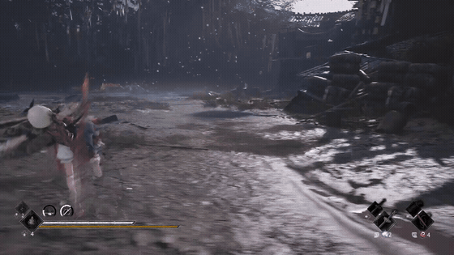

# 影之刃零 · 暖暖（Nikki）替换魂 mod

把《影之刃零》（Phantom Blade Zero）主角「魂」的模型换成「暖暖 Nikki」。现在有两套可选。

- 📥 下载 / Download：[Nexus Mods 页面](https://www.nexusmods.com/phantombladezero/mods/1362)
- 游戏：Phantom Blade Zero（UE 5.7，Steam build 26367565）
- 替换对象：主角魂

## 两套模型（二选一）

同一个 mod 里放两套文件，只装一套：

| 套 | 衣服 | 下载文件 | 出包名前缀 |
|---|---|---|---|
| 1 | 无限暖暖原版（短裙） | Nikki-Infinity-Nikki-PBZ.zip | `zzz_Nikki_P.*` |
| 2 | 熠熠舞曲（紫色长拖尾舞裙） | Nikki-Wuyu-PBZ.zip | `zzz_NikkiWuyu_P.*` |

两套都替换魂。两套同时放进 `~mods` 会冲突，只能放一套。

## 效果

- 进游戏后，有魂的场景都会显示暖暖。
- 动作从魂重定向到暖暖，手部做了 IK 对齐。
- 衣服和头发有基础物理摆动。
- 第二套是长拖尾裙，打架时裙子会穿模、飘得夸张。这是故意的：加碰撞会炸，所以不开碰撞。

### 挥剑演示

## 安装

1. 先关掉游戏。
2. 从上面选一套，下载对应的 zip。
3. 解压，把里面的 `.pak`、`.ucas`、`.utoc` 三个文件复制到游戏的 mod 目录：
   `...\PBZ\ProjectPBZ\Content\Paks\~mods\`
4. 启动游戏。

一次只放一套，不要和别的替换 mod 混用。

## 卸载

把这三个文件从 `~mods` 删掉即可。

## 构建

本仓库只放 mod 配置和脚本，**不含模型原始贴图和 FBX**（版权原因，需自备）。

构建依赖通用工具链 `yzr-zero-mod`：
https://github.com/627157746/yzr-zero-mod

第一套（无限暖暖原版）：

1. 把根目录的 `mod.json`、`export_fbx_real.py`、`export_fbx.py`、`wgfix.py` 放进工具链的 `mods/nikki/`。
2. 把 `Nikki_2.0.blend` 放进 `mods/nikki/`。
3. 用 Blender 跑 `export_fbx_real.py`，生成 `input/fbx/Nikki.fbx` 和 `input/textures/*.png`。
4. 运行 `pwsh tools\build-mod.ps1 -Mod nikki` 出包。

第二套（熠熠舞曲）：

1. 把 `wuyu/mod.json`、`wuyu/export_wuyu.py` 放进工具链的 `mods/nikki-wuyu/`。
2. 准备 `Nikki熠熠舞曲_5.0_B2.blend`。
3. 用 Blender 跑 `export_wuyu.py -- <blend绝对路径> <out_fbx> <out_tex> 2048`，得到 FBX 和 4 张图集贴图。
4. 把 FBX 放到 `input/fbx/NikkiWuyu.fbx`，贴图放到 `input/textures/`。
5. 运行 `pwsh tools\build-mod.ps1 -Mod nikki-wuyu` 出包。

构建笔记见 [`docs/BUILD_NOTES.md`](docs/BUILD_NOTES.md)。

## 文件

- `mod.json`、`export_fbx_real.py`、`export_fbx.py`、`wgfix.py`：第一套（无限暖暖原版）。
- `wuyu/mod.json`、`wuyu/export_wuyu.py`、`wuyu/安装说明.md`：第二套（熠熠舞曲）。
- `docs/安装说明.md`、`docs/BUILD_NOTES.md`：给玩家的安装说明、构建笔记。
- `media/sword-swing.gif`：挥剑演示。

## 说明

- 模型和贴图来自「无限暖暖 Infinity Nikki」官方资源，版权归原公司所有。本仓库不提供这些资产，仅共享 mod 配置与处理脚本，请勿用于商业用途。
- 本 mod 仅供个人学习与游戏娱乐使用。
